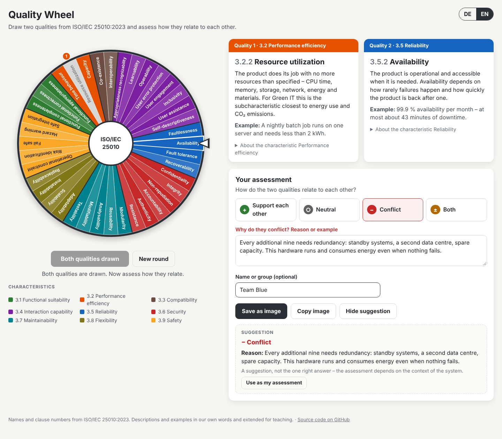

# Quality Wheel

A small web app for teaching software quality with ISO/IEC 25010:2023, made for the iSAQB CPSA-F training of
software architects. A wheel holds the 40 subcharacteristics of the product quality model, coloured by their 9
characteristics. Spin it twice to draw two different qualities, read their quality scenarios, and assess how they
interact: do they **support each other**, are they **neutral**, do they **conflict** – or **both**? Then name the
**architecture decision** behind the interaction. The result can be saved or copied as an image, for example for a
slide, a forum post or a whiteboard.

It covers three learning goals of the CPSA-F curriculum: explaining interactions and trade-offs between qualities
(LG 02-03), formulating quality scenarios with context, stimulus, response and measurement (LG 02-04), and
justifying trade-offs between architecture decisions (LG 03-02). German terms follow the CPSA-F curriculum and the
iSAQB glossary.

**Use it in the browser: https://diavolezza.github.io/QualityWheel/** (built from `main` on every push). No sign-up,
nothing is stored on a server.



The app speaks English and German (switch at the top right); everything in this repository is written in English.

## How it works

- The wheel shows all 40 subcharacteristics. A quality that has been drawn is greyed out and cannot come again in the
  same round; two qualities of the same characteristic are allowed, because many interesting conflicts are inside one
  characteristic (for example confidentiality and accountability).
- Each card shows the clause number, the name, a description and a **quality scenario** (context, stimulus, response,
  measurement), and the characteristic it belongs to. Side by side, the two scenarios make a conflict visible in
  numbers.
- “Prefer trade-offs” (on by default) makes the second draw favour pairs with a conflict: pairs whose suggestion is
  a conflict or both come four times as often as neutral pairs, supporting pairs twice as often. “Draw quality 2
  again” replaces the second quality, for example after a neutral pair.
- The assessment has four options. “Both” asks for one example where the qualities support each other and one where
  they conflict. A second field asks for the **architecture decision**: which decision helps both, causes the
  conflict (and how can it be reduced), or could create a link between neutral qualities.
- “Compare with a suggestion” shows a prepared assessment for the pair, if there is one. The link appears only after
  the students have chosen a relation and written a reason (at least 40 characters), so the suggestion is something
  to compare with, not a shortcut. It cannot be copied into the own assessment. A suggestion is a starting point for
  discussion, not the one right answer – the relation always depends on the context of the system.
- “Save as image” downloads a PNG with both qualities and the assessment; “Copy image” puts it on the clipboard
  (in browsers that support it).

### Suggestions

40 subcharacteristics give 780 unordered pairs. `js/suggestions.js` holds a suggestion for **every one of
them**. A suggestion has a relation (`support`, `neutral`, `conflict`, `both`), a short reason and the architecture
decision behind it, in English and German. A neutral suggestion gives a plain reason why there is no direct link
and usually no decision; where a typical touchpoint exists, it is named in the reason.

```js
"3.2.2|3.5.2": { rel: "conflict",
  conflict: { en: "Every additional nine needs redundancy …", de: "Jede zusätzliche Neun braucht Redundanz …" },
  decision: { en: "Hot standby or second data centre; reduced by warm or cold standby", de: "…" } },
"3.7.4|3.8.1": { rel: "both",
  support:  { en: "…", de: "…" },
  conflict: { en: "Runtime flexibility – configuration options, plugins, rule engines – …", de: "…" },
  decision: { en: "Ports and adapters; runtime configuration and plugins", de: "…" } }
```

The key is the two clause numbers in numeric order, joined by `|`. `node tools/check-data.mjs` checks the catalogue
and all suggestions (also run by the GitHub workflow before publishing).

### Launch options

For teaching and tests: `index.html?lang=de` sets the language, `pick=3.2.2,3.6.1` starts with these two qualities
drawn, `rel=both` preselects an assessment, `teacher` makes the suggestion available at once (for demos and the debrief),
`teacher&suggest` opens it.

## About the texts

The names, clause numbers and structure follow ISO/IEC 25010:2023. The text of the standard is copyrighted, so the
descriptions and quality scenarios in this app are written in our own words and extended for teaching; they do not replace
the standard.

## Running it

There is nothing to build. Open `index.html` in a browser – it also works from the file system – or serve the folder
with any static web server, for example `python3 -m http.server 8080`. The workflow `.github/workflows/pages.yml`
publishes the app on GitHub Pages.

| Path | Content |
|---|---|
| `index.html`, `css/` | page and styles |
| `js/data.js` | the 9 characteristics and 40 subcharacteristics with quality scenarios, in English and German |
| `js/suggestions.js` | suggested assessments for pairs |
| `js/i18n.js` | texts of the user interface |
| `js/wheel.js` | the wheel (canvas) |
| `js/sound.js` | clicks and bell of the wheel (Web Audio API) |
| `js/export.js` | the exported image |
| `js/app.js` | page logic |
| `tools/check-data.mjs` | consistency check for the data |

## License

MIT, see `LICENSE`.
